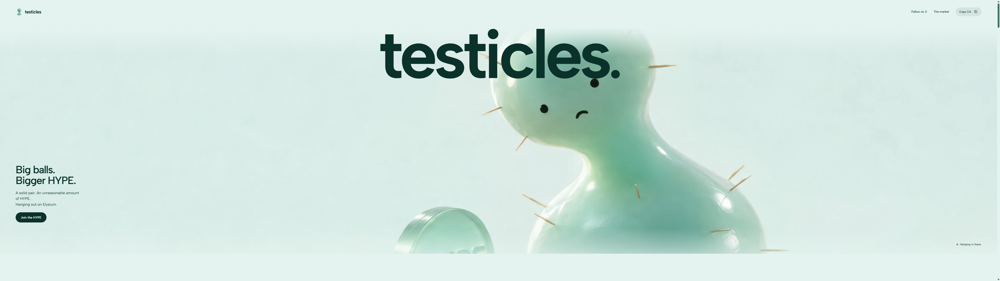
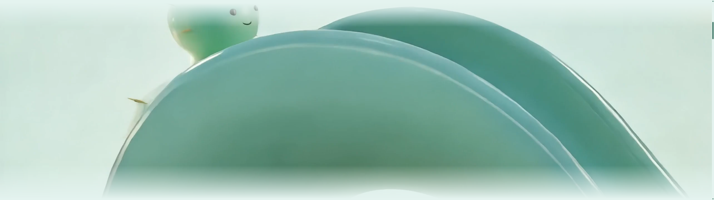

# The remaining desktop handoff stall

This follow-up isolates the 95ms gap reported after the earlier desktop repair. It preserves the site's scene order, character action, camera geometry, typography, copy, source media and phone animation path.

## Confirmed cause

The gap was real: it also occurred with CPU profiling and Chrome tracing disabled. During the first handoff, Chrome's compositor was building an intermediate render pass for the large CSS gradient mask. Detailed layer snapshots mapped the expensive pass to `.entry-crop`: 126 tiled mask quads plus the animation surface. The original masked opening artwork also added unnecessary offscreen compositing on return.

The long work was in `VizCompositorThread` / `DirectRenderer::DrawRenderPass`, rather than a main-thread JavaScript loop or forced reflow. In the detailed recording, the largest compositor draw took 70.9ms; its expensive render pass took 64.8ms. This explains why the page's JavaScript could appear healthy while scrolling visibly stopped.

## Repair

- The desktop entrance now applies its existing gradient inside the same 2560×1440 worker surface that already displays each frame. It uses the original crop geometry and the same easing, positions and gradient stops. The browser no longer has to create the large tiled CSS-mask pass for that surface.
- The opening's desktop edge fade uses an equivalent gradient over its solid background. The first page's artwork, video, timing, text and composition are preserved. The phone continues using its original masks and native media path.
- The main story remains on its existing opaque surface. No extra mask work is applied to later scenes.
- Resize updates pass fresh mask geometry to the worker. Native fallback restores the original CSS mask only when the corresponding native frame is ready, so it cannot double-mask or blank the retained picture.

No source video or image was re-encoded, downsized or replaced. No new generated art, subscription or credit spend was used.

The release is live on [Vercel](https://testicles-xi.vercel.app/?v=mask-fix) and the [existing server](https://testicles.84.32.214.33.sslip.io/?v=mask-fix), deployment `dpl_3qDYLvmZcVn8U1JAaHadXmYWXEeo`. Both endpoints returned the new `index-3FzxoJt_.js` bundle.

## Measured local validation

Tests used the compiled production build and the same 5120×1440 viewport on the available Windows server. Its Chrome graphics path is software-rendered ANGLE/WARP, not the owner's physical G9 GPU.

| Measurement | Before | With composited entrance mask |
|---|---:|---:|
| Largest detailed compositor draw | 70.9ms | 19.1ms |
| Largest detailed render pass | 64.8ms | 12.4ms |
| Largest page animation-frame gap, first low-overhead full-story run | 116.7ms | 33.4ms |
| Largest story-frame interval, that run | 114ms | 33ms |

A subsequent full-story run kept the page animation-frame clock within 16.8ms. That run recorded a 101ms interval between the final two source images after input stopped; those images were only one source frame apart as the original scrub easing settled. It is an intentional held source image, not the original compositor freeze. Ordinary source-delivery intervals still vary with decoding load and must not be confused with a guarantee of one fresh image on every display refresh.

The fast wheel/reversal test included both the entrance and later story, six rapid travel/reversal legs and seven abrupt jumps. No moving-scene stall above its stricter 80ms threshold, blank checkpoint, JavaScript error or main-thread long task was observed in the local run. Repeated opening-return tests also exercised the preserved first-page playback.

## Published-build verification

Two low-overhead full-story runs on the actual public release kept the page animation-frame clock at a 16.8ms maximum. The second run explicitly recorded input start/end times: during active scrolling, story image delivery had a 17ms median, 21ms p95 and 36ms maximum. No main-thread long task was recorded. The former 95ms handoff/compositor stop did not recur.

The unfiltered source-image log still has a 99ms gap after scrolling stopped. Its two images differ by only one 1/60-second source frame while the original scrub easing settles. The log retains that value; it is excluded only from the separately labelled active-scrolling interval calculation. This distinction prevents intentional held images from being reported as frozen scrolling.

The final public Chrome (5120×1440) and Edge (2560×1440) wheel/reversal runs both completed with every checkpoint ready, zero JavaScript errors, zero reported main-thread long tasks and no moving-scene stall above 80ms. Rendered desktop and phone views were also inspected after publication; the temporary viewport override was reset afterwards.

## Appearance and safety checks

Before/after screenshots at three entrance positions had SSIM 0.9983–0.9988. The opening comparison was 0.9986. These comparisons verify close rendering equivalence rather than mathematically identical screenshots; the source assets themselves are unchanged. Visual inspection confirmed the same composition and feathered edges.

Twenty regression tests pass, including crop-mask endpoints, full 2K output dimensions, opaque later-story rendering, resize-message deduplication, fallback mask restoration, bounded decoding, fast reversals, deadlines and cleanup. The project checks also compare the original opening media, typography, layout, camera code and controls, allowing only the explicit desktop mask-rendering changes.

The recording scripts now support a low-overhead mode (`--light=yes`) and detailed compositor inspection (`--deep=yes`). Detailed layer snapshots can themselves add measurement overhead; they are used to locate work, while low-overhead runs and native wheel input assess pacing. [Chrome documents the overhead of detailed recording options](https://developer.chrome.com/docs/devtools/performance/overview).

## Evidence

Raw measurements and traces are retained under `.project-state/performance-investigation/`:

- `95-light-cold-5120`: original public build without heavy profiling.
- `95-deep-viz` and `95-quads`: original compositor timing and layer/quad snapshots.
- `95-composited-mask` and `95-composited-mask-deep`: first successful repair comparison.
- `95-final-local-full`: repeated full-story pacing check.
- `95-final-wheel-5120`: native wheel and reversal test with an 80ms threshold.
- `95-final-live-cold` and `95-final-live-verified`: actual published-build pacing, including exact input timing in the latter.
- `95-final-live-wheel` and `95-final-edge-wheel`: public native wheel/reversal checks.
- `.project-state/95ms/visuals/`: before/after opening and entrance screenshots.

The earlier reports remain historical evidence. Their remaining 95ms compositor issue is the specific issue addressed here; they should not be read as measurements of this new renderer.

## Preserved appearance

Opening, with the same video, composition and typography:

The same feathered transition, rendered without the large CSS-mask pass:

