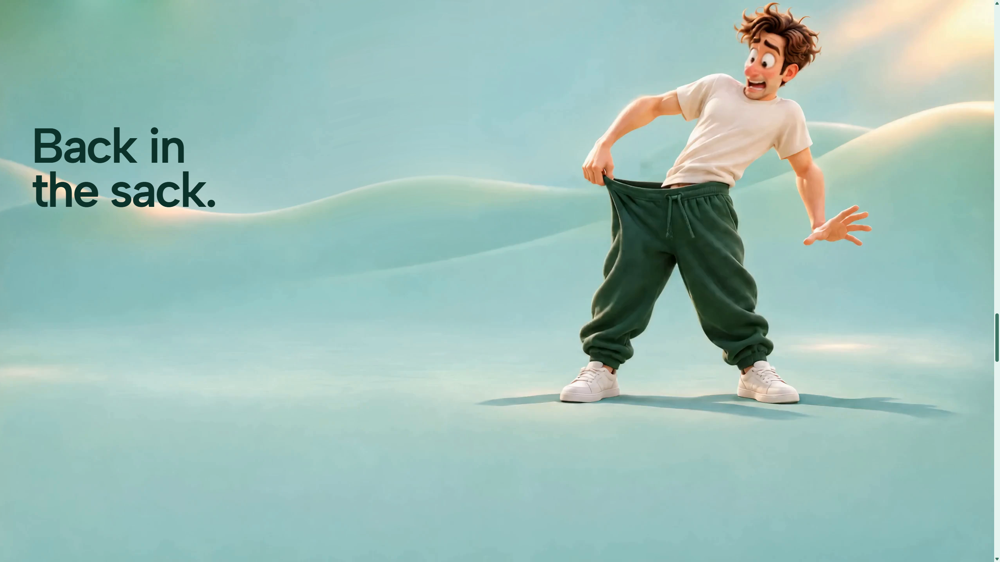

# Desktop mask performance and background repair — 9 November 2026

The sharp mint background edge was present in the video frames themselves. It came from the earlier clean-plate repair used to remove the travelling slide. The affected desktop footage is now repaired and published on [the main Windows-hosted website](https://testicles.84.32.214.33.sslip.io/). This release also retains the tested one-column entrance-mask optimization. The opening, phone films, layout, copy, camera timing and desktop 2K resolution remain unchanged.

## What changed

### Baked background seam

The discontinuity can be reproduced by decoding the old desktop MP4 outside a browser. It is therefore separate from CSS, ScrollTrigger and video presentation performance. A patch in the old slide-removal pass did not follow the continuous dune ridge as the camera moved.

`scripts/repair-story-background.py` reconstructs the affected ridge from intact cross-sections on each side, with tracked position, smooth geometry and feathered temporal entry/exit. The jumping mascot is protected with a foreground mask when he crosses the repaired area. The repair introduces no runtime compositing layer or per-frame JavaScript work.

`scripts/package-background-repair.mjs` packages the result as the desktop `scroll-frames-v3/story` stream and the native fallback `story-desktop-clean-60-2k.mp4`. Only frames 586–1049 are replaced. All 941 frames outside that interval retain their original WebCodecs packet bytes; decoded native-fallback frame hashes also match outside that interval. The original assets remain available for cached older pages and rollback.

The stream still contains 1,405 frames at 2560×1440 and 60fps. Its ten compressed parts total 119,370,353 bytes, within the existing 128MiB compressed-frame cache limit. The native fallback is 82,595,010 bytes. No new generated assets or provider credits were used.

### Entrance-mask backpressure

Worker instrumentation of the prior full-size mask found a 46ms median / 53ms p95 / 116ms maximum interval between submitting an entrance frame for decode and receiving its callback. Packet retrieval during the measured scrolling interval was effectively zero. Removing drawing in a local diagnostic reduced this to 6ms median / 7ms p95 / 10ms maximum. This isolates presentation backpressure in the available test environment; it does not establish the graphics configuration of every visitor's PC.

The entrance feather varies only vertically. `src/independent-worker.js` now rasterizes that gradient into a 1×1440 alpha strip and stretches it over the original 2560×1440 frame. Its colors, stops, geometry and timing are unchanged. Six fixed opening/entrance comparisons were pixel-identical. The opaque story path, two-frame pending limit, request cancellation, watchdogs, cache limits, native fallback and disposal remain intact.

No React render path, new animation engine, additional ScrollTrigger or new animation loop was added. The phone continues using its existing native video path and never creates the desktop worker canvases.

## Published-build benchmarks

Tests ran sequentially against the public server, using the production bundles, on the available Windows machine. Its renderer is Microsoft ANGLE/WARP software graphics. This is not the owner's physical Samsung monitor/GPU combination. Both a 5120×1440 viewport and a normal 2560×1440 desktop viewport were tested; resolution was not assumed to be the cause.

Each fast-scroll run used twelve native wheel legs with repeated direction reversals, followed by seven discontinuous position changes. Frame-age measurements use `performance.now()` and count active movement separately from intentional stationary holds and the ending idle video.

| Public production run | Story/entrance frame notifications | Ready checkpoints | Largest moving-frame age | rAF p95 / maximum | Main-thread long tasks |
|---|---:|---:|---:|---:|---:|
| Chrome, 5120×1440, screenshot checkpoints enabled | 1,202 | 19/19 | 37ms | 16.8 / 99.9ms | 0 |
| Edge, 2560×1440 | 1,223 | 19/19 | 22ms | 16.7 / 33.4ms | 0 |
| Chrome, 5120×1440, capture-free repeat | 1,208 | 19/19 | 42ms | 16.8 / 16.8ms | 0 |

The 99.9ms rAF interval in the screenshot-enabled Chrome run occurred while stationary at the first screenshot checkpoint, after the target frame had arrived. Repeating the same route without screenshot capture removed it. `scripts/stress-scroll.mjs` now accepts `--screenshots=no` so the benchmark can separate capture overhead from active motion. The raw screenshot-enabled result is retained, not discarded.

A separate 24-second, cold-browser-cache production run at 5120×1440 recorded 1,420 story updates during scrolling. Story-frame intervals were 17ms median, 20ms p95 and 42ms maximum. rAF p95 and maximum were both 16.8ms; no main-thread long task or JavaScript error occurred. A 98ms notification interval outside the scrolling window remains in the raw data and is not counted as active scrolling. Earlier pre-repair cold runs contained genuine gaps as high as 69ms; those records remain available too.

These results show improvement in the tested routes. They are not a guarantee of a new image on every refresh or zero stutter on every device, network or browser.

Reproduce a capture-free full-story run:

```powershell
node scripts/stress-scroll.mjs --url=https://testicles.84.32.214.33.sslip.io/ --label=desktop-repeat --width=5120 --height=1440 --repeat=2 --stall-ms=60 --screenshots=no
```

The script uses the dedicated test browser's CDP endpoint on port 9339. It does not change the visitor's browser settings.

## Visual and regression verification

- Inspected the actual public desktop story forward and backward through the damaged region. Captured 11.3s, 13s and 16.8s positions, then returned to 13s. The dune remains continuous and the foreground mascot remains intact.
- Inspected the public phone opening and scrolling story at 390×844. It still loads `story-phone-seek-2k.mp4` at 2048×2048, with no desktop canvases. Reset the temporary viewport afterward.
- Verified the original opening plays at 2560×1440. Its markup, assets and animation code were not edited.
- The production build, all 23 regression tests, media-dimension checks, packet-size checks and unchanged-frame checks pass. Full native fallback decoding completed without an error.
- Both new public frame assets and the JavaScript bundle match the built files byte for byte. The native fallback returns HTTP 200 with the expected byte length.



## Deployment and retained evidence

Published to the existing dedicated Testicles release on the Windows server at 2026-11-09 11:36:49 UTC. No service restart or proxy change was needed. New main bundle: `index-DlNB2mIy.js`; worker: `independent-worker-BXSWJQHs.js`. Vercel is no longer the deployment target, per the user's instruction.

Raw evidence is retained under `.project-state/performance-investigation/`: `71-worker-baseline`, `71-worker-decode-only`, `71-worker-mask-row-repeat`, `71-comparison`, `71-final-compositor`, `seam-clean-local`, `seam-final-chrome-5120`, `seam-final-edge-2560`, `seam-final-chrome-no-capture` and `seam-final-cold-5120`. Frame hashes, packaging receipt, tracking, intermediate repair checks and live screenshots are in `.project-state/seam-repair/`. Reproducible tracking is committed in `source-assets/seam-repair-tracking.json`.
