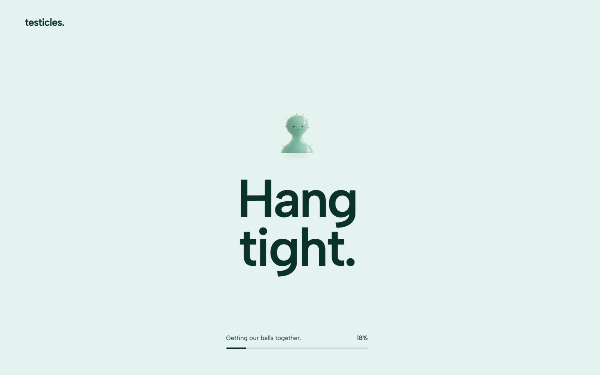

# Desktop stutter and loading screen — 9 November 2026

The site now prepares the selected 2K experience behind a branded loading screen. It holds normal scrolling and keyboard focus until the opening, complete story media, first decoded frames, fonts and posters are ready. It then reveals the approved opening. The original page design, camera geometry, copy, source movies and phone animation remain intact.

## What changed

| Before | After | Purpose |
|---|---|---|
| Visitors could scroll while media was still arriving | A real readiness gate with an animated mascot, progress and a curtain exit | Prevent entry into an unfinished story |
| Native preload could buffer only part of the phone film | Complete, verified-length media is held in browser-owned in-memory files before playback | Keeps subsequent seeks independent of further downloads |
| Desktop background prefetch had no completion signal | Workers report received bytes and complete-part readiness | Release the loader only after the selected stream is available |
| Legacy images waited for FileReader and a load event before decoding | Bounded byte encoding followed by immediate decode | Removes two serial scheduling waits |
| Failed loading could leave a permanent cover | Explicit error state, retry and open-anyway actions, plus a stalled-progress watchdog | Provides a bounded recovery path |

Startup is isolated in src/startup.js and src/startup.css. The approved src/main.js, src/style.css, src/story.css and src/entry.js remain byte-identical. The loader pauses their motion until reveal rather than rewriting it. The native video files and frame artwork are unchanged: no resizing, retiming, recompression or generation was performed.

Only the active delivery variant is loaded. H264 compressed buffers stay within the existing 128MiB budget. The complete JPEG compatibility story is about 180.2MB and is permitted up to 192MiB; its entry is about 19.6MB. Decoded frames are still released as playback advances. Native movie object URLs are revoked on a non-cached page exit. The Testicles media CSP now allows browser-owned blob URLs; other origin and script restrictions are unchanged. The related CallrHttps proxy was restarted once to apply that single-host header update; the separate caddy service was not changed.

## Investigation

The earlier 49ms result came from the oldest compatibility mode. A 16-second Edge Performance recording separated preparation from presentation: FileReader took 3ms median / 8ms p95, then the image decode wait took 19ms median / 31ms p95. Replacing an already-decoded image took at most 1ms. The revised path eliminated FileReader work and measured a 17ms median / 24ms p95 decode wait. This uses the [documented early image-decoding pattern](https://developer.mozilla.org/en-US/docs/Web/API/HTMLImageElement/decode).

Instrumented traces have appreciable overhead on this Microsoft software-graphics host. Their rAF maximum changed from 83.3ms to 66.7ms; these are not ordinary-use measurements. Separate unprofiled candidate tests initially measured 33ms maximum picture age, but broader runs retained outliers. Therefore the work does not establish that every 49ms stutter has been eliminated.

Alternative viewport-layer, WebGL-texture, concurrent-decoder and shorter-flush experiments did not produce a reliable improvement on the test host. They were removed. The selected release keeps the existing presentation and decoder cadence, with earlier legacy decoding and complete-media preparation.

## Public verification

Published to https://testicles.84.32.214.33.sslip.io/ on 9 November 2026. The public page and bundles were checked against the production build. Vercel was not modified.

Each desktop run used twelve fast native-wheel legs with immediate direction reversals and seven abrupt jumps:

| Public path | Ready checkpoints | Maximum moving-picture age | rAF p95 / maximum | JS errors / long tasks |
|---|---:|---:|---:|---:|
| Normal desktop, Chrome, 2560×1440 | 19/19 | 50ms | 16.7 / 33.4ms | 0 / 0 |
| Image-worker compatibility, 2560×1440 | 19/19 | 46ms | 16.8 / 50.1ms | 0 / 0 |

No blank checkpoint or sustained freeze was observed in those runs. They still include occasional frame-time outliers. More demanding synthetic tests with both workers and ImageBitmap disabled at 5120×1440 remained slower on software graphics; the loader cannot remove the cost of decoding and displaying every future frame. No universal stutter-free claim is made.

The public phone readiness check ran at 390×844, with zero desktop canvases. It verified complete buffers for the original 6.04-second opening, 4.04-second entrance, 23.42-second story and 1.58-second ending loop. The story and ending remain 2048×2048. Scrolling stayed locked until readiness. A public #pants visit restored the correct section after loading. The original opening and closing compositions were inspected on phone and desktop.

A forced media failure exposed a recovery-state race; it was fixed and rechecked. Retry and open-anyway remain usable, and continuing removes the cover and restores page interaction. Reduced-motion styling removes the mascot sway and uses a short opacity exit. Hidden tabs pause decorative loader motion.

The release passes 35 focused tests and the connected-media checks. Test logs, raw traces, readiness samples and screenshots are retained under .project-state/stutter-49/ and .project-state/performance-investigation/. The source and report are uploaded to the private missfitchief/testicles repository.

## Practical limits

All story bytes are ready before entry; decoding remains on demand to avoid retaining tens of gigabytes of decoded 2K frames. Initial waiting time consequently depends on connection speed. The loader improves startup correctness and download independence, but the measured residual frame outliers mean the original request for completely smooth playback on every PC is not fully proven.
