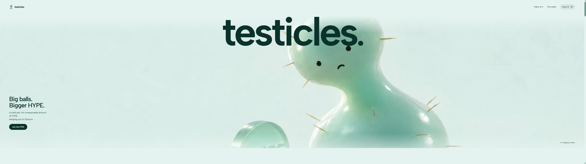
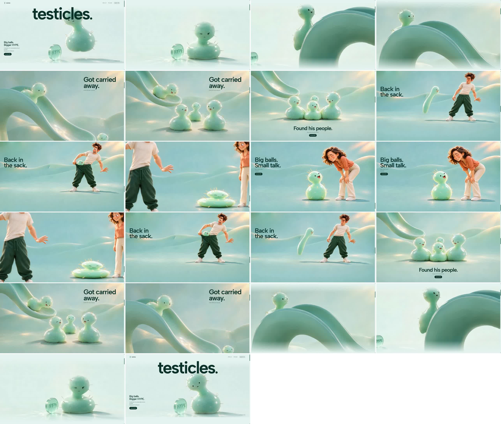

# Desktop scroll retest — 9 November 2026

The repeated production tests found another opening-return compositing hitch. A small desktop-only rendering change is now published. The final native-wheel runs completed 53 checkpoints without a blank checkpoint, JavaScript error, main-thread long task, or moving-scene stall above 80ms. Shorter frame-delivery gaps remain; this is not a claim of perfectly uniform 60fps on every computer.

Live: [Vercel](https://testicles-xi.vercel.app/?v=departure-fix) · [Windows server](https://testicles.84.32.214.33.sslip.io/?v=departure-fix).

## Additional cause and change

Repeated travel between the opening and slide produced an 83.3ms animation-frame gap in a low-overhead scripted run and a 66.7ms maximum in native-wheel testing. The diagnostic Chrome trace showed `LayerTreeHost::WaitForCommitCompletion` inside the expensive scroll work. Individual layout events stayed below 0.4ms. Fading the entire hero as one translucent group was still making the compositor do unnecessary work.

`src/departure-fade.js` now fades a solid cover in the existing paper background color during desktop departure. This produces the same result as fading the hero over that background, while keeping the hero itself opaque and avoiding the large intermediate group. The original fade curve, camera movement, media playback and reset timing remain in `src/entry.js`. The new cover is reused and cleaned up; it adds no event listener or animation loop.

The phone continues using the original opacity assignment. It never creates the desktop cover. No source image, video, frame packet, resolution, frame rate, copy, layout or character action changed.

## Final published-build measurements

Tests ran sequentially on the available Windows server with Chrome and Edge, using native wheel gestures, abrupt direction changes, discontinuous jumps, and repeated opening returns. This machine uses Microsoft's software graphics path, not the owner's physical G9 graphics card. The 5120×1440 test size reproduces the reported viewport; it is not an assumption about the cause.

| Final run | Viewport | Checkpoints ready | Frame-clock p95 / maximum | Largest moving-frame age | Stalls >80ms |
|---|---|---:|---:|---:|---:|
| Chrome, fast full-story reversals | 5120×1440 | 19 / 19 | 16.7 / 33.3ms | 62ms | 0 |
| Edge, fast full-story reversals | 2560×1440 | 19 / 19 | 16.8 / 33.4ms | 35ms | 0 |
| Chrome, repeated opening returns on server URL | 5120×1440 | 15 / 15 | 16.7 / 33.4ms | 71ms | 0 |

All three runs recorded zero JavaScript errors and zero main-thread long tasks. Chrome presented 1,183 frame updates in its full-story run; Edge presented 1,220. The opening-return run presented 990 updates across its entrance and later-story checks.

A separate cold-browser-cache test of the public Vercel release had a 33.4ms maximum frame-clock gap. During active scrolling, later-story image delivery had a 17ms median, 20ms p95 and 46ms maximum. Loading and decoding still cause occasional shorter gaps: the native Chrome full-story run had two sampled frame ages over 50ms, and the repeated entrance run had twelve. These values are retained rather than being described as zero stutter.

The benchmark now uses `performance.now()` consistently for frame age. The rAF callback's supplied timestamp can predate an intervening frame notification and previously produced negative ages. It also treats the intentionally playing ending video separately from the paused scroll canvas, so an ending hold is not counted as a decoder freeze. The 80ms threshold is explicit; passing it does not establish one new source image on every refresh.

## Appearance and regression verification

- Inspected 22 full-story screenshots in both directions, from the opening through the final conversation and back. No blank or broken image appeared.
- Compared six fixed opening/entrance positions before and after. The opening and four transition samples were pixel-identical; the remaining sample had SSIM 0.999896.
- Confirmed the desktop canvases remain 2560×1440 and the phone story remains 2048×2048. The desktop source remains 60fps.
- Visually inspected the published opening, ending and phone layout. Phone media reached ready state, the ending video played, and no desktop cover existed at the phone breakpoint. Reset the temporary viewport afterwards.
- All 23 regression tests pass, including desktop-cover reuse, phone-path preservation, breakpoint cleanup, frame delivery, reversal handling, fallback and disposal. The production build and original-media/camera/layout checks pass.

Opening preserved:

Forward and reverse visual checkpoints:

## Release and evidence

Vercel deployment: `dpl_D8z2XMo6x1ByacaiA6B2WckBpgoU`. Both public origins returned HTTP 200 and the new `index-C4hFvZ77.js` / `index-VG0EptP9.css` bundles. The worker and media assets are unchanged. The Windows deployment required no service restart.

Raw evidence is retained in `.project-state/performance-investigation/`: `repeat-cold-chrome-5120`, `repeat-server-entrance-5120`, `repeat-entrance-trace-5120`, `repeat-native-entrance-5120`, `repeat-cover-confirmed`, `repeat-candidate-native-entry`, `repeat-candidate-full`, `repeat-comparison`, `repeat-visual-check`, and the four `repeat-final-*` runs. `repeat-final-results.json` contains the final native-wheel summaries and uncapped maximum moving-frame ages.
